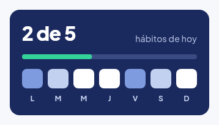
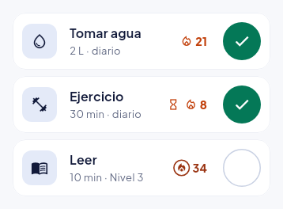
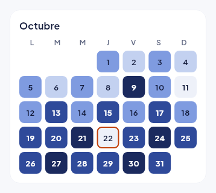

# Paso 2 · Sistema de diseño (F1)

**Estado:** terminado · **Fecha:** 24-nov-2026 · **IA:** asistido (Claude), revisado por Samuel Rizo

El tema y los componentes reutilizables de la app, sacados de los bosquejos de Figma (29 pantallas). Ninguna pantalla
define colores, tamaños de letra ni formas propias: todo sale de `lib/ui/core/tema/` y de los componentes de
`lib/ui/core/widgets/`. **Solo hay tema claro.**

## Archivos

| Archivo | Qué contiene |
|---|---|
| `ui/core/tema/colores.dart` | `KaizenColores`: los tokens de la paleta, la escala de intensidad 0–4 y las series de las gráficas |
| `ui/core/tema/tipografia.dart` | `KaizenTipografia`: la escala de textos con Plus Jakarta Sans |
| `ui/core/tema/medidas.dart` | `KaizenMedidas`: radios, alto del botón, lados del ícono y del check, espacios (múltiplos de 4) |
| `ui/core/tema/iconos.dart` | `KaizenIconos`: íconos de navegación y acciones, y el ícono de cada categoría |
| `ui/core/tema/tema.dart` | `KaizenTema.claro()`: `ThemeData` de Material 3 con el `ColorScheme` armado a mano |
| `ui/core/widgets/*.dart` | 18 componentes (tabla abajo) |
| `ui/dev/galeria_componentes.dart` | Galería con todos los componentes, solo en depuración |
| `utils/fechas.dart` | Meses y días en español, semana de lunes a domingo (el Paso 4 agrega los formatos completos) |
| `assets/fuentes/plus_jakarta_sans/` | Fuente en 5 pesos (400–800) y su licencia OFL |

## Paleta

Los colores se midieron con cuentagotas sobre los PNG de los bosquejos ("Escritorio 02 Inicio", "Escritorio 08
Cápsula", "Móvil 03 Crear hábito" y "Web 01 Login").

| Token | Hex | Uso |
|---|---|---|
| `marino900` | `#121A3A` | Riel lateral, barra de título, texto principal |
| `marino800` (**primario**) | `#1B2A5E` | Tarjeta "2 de 5", botones principales, check cumplido, chip elegido |
| `marino700` | `#3A4A82` | Pista de la barra de progreso sobre la tarjeta oscura |
| `azul600` | `#2F4A9A` | Destino activo del riel, enlaces, texto de ayuda |
| `azul400` | `#7F9BE0` | Intensidad media del calendario y de la semana |
| `azul200` | `#C3D1F0` | Intensidad baja, barras secundarias |
| `azul100` | `#E4EAF8` | Tarjeta de sugerencia, fondo del ícono de hábito, segmentado |
| `azul50` | `#EEF1F9` | Día sin registro, pista de las barras claras |
| `textoSobreMarino` | `#AEBCDE` | Texto secundario sobre `marino800` |
| `fondo` | `#F7F8FB` | Fondo de las pantallas |
| `superficie` | `#FFFFFF` | Tarjetas y campos |
| `borde` | `#EEF0F6` | Borde de las tarjetas |
| `bordeCampo` | `#E4E8F1` | Borde de campos, chips y botón secundario |
| `bordeControl` | `#C9D1E3` | Círculo del check-in sin marcar |
| `textoSecundario` | `#606882` | Subtítulos ("2 L · diario") |
| `naranjaRacha` (**acento**) | `#C2410C` | Llama y número de racha, reloj de arena, botón "Abrir", "Suspendido" |
| `naranjaClaro` | `#F0763F` | Rayo de la cápsula abierta y anillo de la cápsula |
| `avisoFondo` / `avisoTexto` | `#FFF4DB` / `#7A4F00` | Avisos ("La foto solo se agrega desde Android…") |
| `error` / `errorFondo` | `#B3261E` / `#FBE9E7` | Errores |

- **Escala de intensidad** (calendario, semana y mapa de calor), del nivel 0 al 4: `azul50`, `azul200`, `azul400`,
  `azul600` y `marino800`. Sobre los niveles 3 y 4 el texto va en blanco.
- **Gráficas:** serie principal `marino800`, secundarias `azul400` y `azul200`, resaltado `naranjaRacha`.
- **Contraste:** todos los pares de texto y fondo cumplen WCAG AA (≥ 4.5:1). Hay una prueba que lo comprueba.

## Tipografía

**Plus Jakarta Sans** (licencia OFL), incluida en la app como *asset*: funciona sin internet y se ve igual en todas
las plataformas. Viene de `github.com/tokotype/PlusJakartaSans` (commit `18d1cd2`).

| Estilo | Tamaño / peso | Ejemplo |
|---|---|---|
| `displayLarge` | 44 / 800 | Marca "Kaizen" |
| `displayMedium` | 32 / 800 | "2 de 5", "1,204" |
| `headlineLarge` | 28 / 800 | Título de pantalla ("Hoy") |
| `headlineSmall` | 20 / 800 | "10 → 12 min", "5 min" |
| `titleMedium` | 16 / 700 | Título de tarjeta y de hábito |
| `titleSmall` | 14 / 700 | Etiqueta de campo ("Nombre") |
| `bodyMedium` | 14 / 400 | Cuerpo |
| `bodySmall` | 13 / 400, gris | Subtítulos |
| `labelLarge` | 15 / 700 | Botones |
| `labelMedium` | 13 / 600 | Chips y segmentado |
| `labelSmall` | 12 / 600 | "L M M J V S D" |

## Logo

Desde el Paso 5, el logo es un **ensō** (círculo zen de pincel) con piedras que suben como una escalera hasta una
flor de cerezo en naranja coral: la meta se alcanza paso a paso. Usa la paleta de la app (marinos y azules, con el
naranja de la racha).

- En la app: `assets/imagenes/logo_kaizen.png` (512 px, fondo transparente), dentro de `LogoKaizen`.
- Íconos de Android (clásico y adaptable), iOS, macOS, web (incluido *maskable*) y Windows: se generan con
  `herramientas/generador_logo/iconos.py` (fuera del repo de la app) a partir del mismo dibujo.

## Formas e íconos

- Tarjetas con radio 16 y borde de 1 px. Campos y botones con radio 12. Chips en píldora. Celdas del calendario con
  radio 8.
- Botón principal de **52 px** de alto. El círculo del check-in mide **48 px**, el mínimo de área de toque.
- Íconos de línea de Material (*outlined*, vienen con Flutter). La escalera de la marca y de la Escalera Kaizen se
  dibuja (`IconoEscalera`), porque Material no trae ese trazo.
- **El ícono de cada hábito sale de su categoría** (`KaizenIconos.deCategoria`), sin importar mayúsculas ni
  acentos. Una categoría nueva creada por el admin recibe el ícono genérico.

| Categoría | Ícono |
|---|---|
| Aprendizaje | `translate` |
| Ejercicio | `fitness_center` |
| Finanzas | `savings_outlined` |
| Hidratación | `water_drop_outlined` |
| Lectura | `menu_book_outlined` |
| Meditación | `self_improvement` |
| Salud | `favorite_border` |
| Sueño | `bedtime_outlined` |

## Componentes

| Componente | Dónde se usa | Notas |
|---|---|---|
| `TarjetaKaizen` | Todas las tarjetas | Estilos `normal` (blanca), `destacada` (`marino800`, texto blanco) y `suave` (`azul100`); toque opcional |
| `TarjetaKpi` | Panel de admin | Cifra, etiqueta y variación ("+8 %" azul, "−2.5 %" rojo) |
| `FilaHabito` + `BotonCheck` | Hoy, Hábitos | Ícono, nombre, subtítulo, racha y check-in de un toque |
| `IndicadorRacha` | Filas, detalle | Llama y número; reloj de arena si hay cápsula sellada |
| `AnilloProgreso` | Cápsulas | Arco 0–1 con un widget al centro |
| `BarraProgreso` | "2 de 5", cápsulas | Clara u oscura; color configurable |
| `BarraSemana` | "2 de 5", Mi semana | 7 días L–D con intensidad 0–4; `null` = sin dato |
| `CalendarioMes` | Hoy (escritorio), detalle | Semana de lunes a domingo, intensidad por día, hoy con contorno, toque por día |
| `MapaCalor` | Indicador I5 | Filas × columnas; el valor se pasa a la escala 0–4 entre un mínimo y un máximo |
| `SelectorSegmentado` | Frecuencia, periodo | Una opción, en barra `azul100` |
| `ChipsSeleccion` | Categoría, cápsula, días | Una o varias opciones; puede impedir quedarse sin ninguna |
| `ContadorMeta` | Crear hábito | − valor unidad +, con mínimo, máximo y paso |
| `CampoValidado` | Formularios | Etiqueta arriba, ayuda en azul, error en rojo, contraseña con mostrar u ocultar |
| `EstadoCargando` / `EstadoVacio` / `EstadoError` | Toda pantalla con datos | El de error trae "Reintentar" |
| `BannerSinConexion` | Global (Paso 8) | "Sin conexión · N registros por enviar" |
| `AvisoKaizen` | Cápsula, laboratorio | Aviso en ámbar |
| `DialogoConfirmacion` | Archivar, retirar consentimiento, suspender | `mostrar()` devuelve `true` solo si se confirma; variante roja |
| `LogoKaizen` | Entrada, riel, barra web | El ensō (desde el Paso 5): cuadro blanco con el logo; con borde sobre fondo claro |
| `IconoEscalera` | Destino "Escalera" | Escalera dibujada (Material no trae ese trazo) |

**Accesibilidad:** cada componente se anuncia a los lectores de pantalla. Por ejemplo, el check-in dice "Marcar Leer
como cumplido" (es un botón con estado), la racha dice "Racha de 21 días, con cápsula sellada" y cada día del
calendario dice "8 de octubre: nivel 3 de 4". Los textos están en `lib/l10n/app_es.arb`.

### Galería

En depuración, la pantalla inicial tiene el botón **Ver componentes**, que abre la galería con todos los componentes
para compararlos con los bosquejos. En el Paso 3 pasa a la ruta `/dev/componentes`. En *release* no aparece.

| Tarjeta "2 de 5" | Filas de hábito | Calendario |
|---|---|---|
|  |  |  |

## Pruebas

| Tipo | Archivos | Pruebas | Qué comprueba |
|---|---|---|---|
| Unitarias | `test/unit/tema/` (colores, tema, íconos), `test/unit/utils/fechas_test.dart`, `test/unit/widgets/logica_componentes_test.dart`, `test/unit/config/` | 52 | Hex medidos, escala 0–4, **contraste WCAG ≥ 4.5** de 10 pares y de cada nivel; el `ColorScheme` usa los tokens; escala de textos; botón de 52 px; íconos por categoría; meses, bisiestos y desfase de la semana; lógica de chips, formatos y niveles |
| Widget | `test/widget/core/` (5 archivos), `test/widget/dev/`, `test/widget/app/` | 61 | Cada componente: se dibuja, responde al toque, estados (elegido, deshabilitado, vacío, error), semántica, área de toque ≥ 48 px, sin desbordes en 320 px; la galería en móvil y escritorio; la app usa el tema y la galería no aparece en *release* |
| Golden | `test/golden/componentes_golden_test.dart` | 6 | Imágenes de referencia: tarjeta "2 de 5", filas de hábito, botones, calendario, controles del formulario, KPIs y mapa de calor |

**Resultado:** 119 de 119 en verde · `flutter analyze`: sin avisos · **cobertura: 99.3 %** (742 de 747 líneas, sin
contar el código generado de los textos).

| Compilación | Resultado |
|---|---|
| Linux (debug) | ✓ |
| Web (`--no-web-resources-cdn`) | ✓ |
| Android APK (debug) | ✓ |

### Sobre las pruebas golden

- Cargan las fuentes reales (Plus Jakarta Sans y los íconos de Material) en `test/golden/flutter_test_config.dart`.
  Sin esto, Flutter dibuja cada letra como un cuadro.
- Toleran hasta **0.5 %** de píxeles distintos, porque el suavizado de las letras cambia un poco entre sistemas. Las
  imágenes de referencia se generaron en Linux. Si en Windows o macOS fallan solo por el suavizado, corre
  `flutter test --exclude-tags golden`.
- Si un cambio visual es **intencional**, se regeneran con `flutter test --update-goldens --tags golden` y las
  imágenes nuevas se revisan en el commit.

En todas las pruebas, un toque que no llega a su widget (fuera de pantalla o tapado) es un error
(`test/flutter_test_config.dart`).

## Cómo probarlo

```bash
cd app
flutter pub get
flutter analyze
flutter test                              # todas (unitarias, widget y golden)
flutter test --exclude-tags golden        # sin las golden
flutter run -d linux --dart-define=KAIZEN_FUENTE=fake   # botón "Ver componentes"
```

El formato del código usa un ancho de 120 columnas (`formatter: page_width: 120` en `analysis_options.yaml`). Basta
con `dart format .`.
