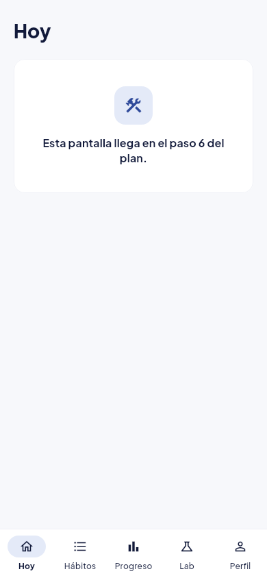
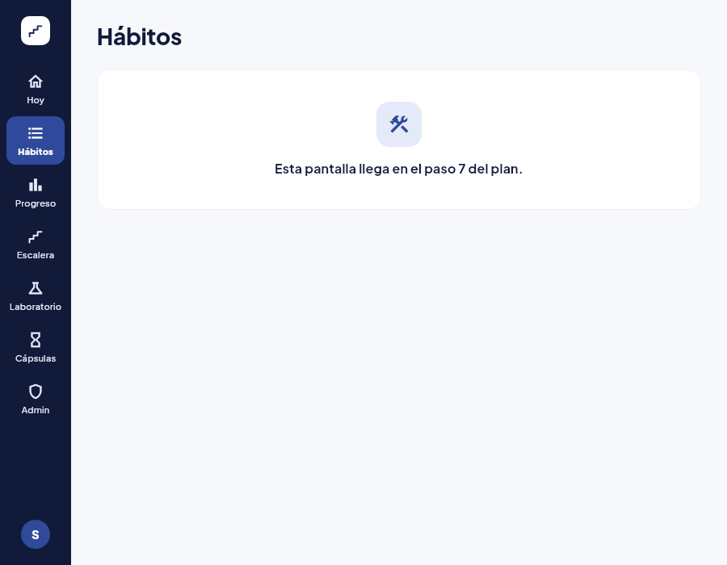
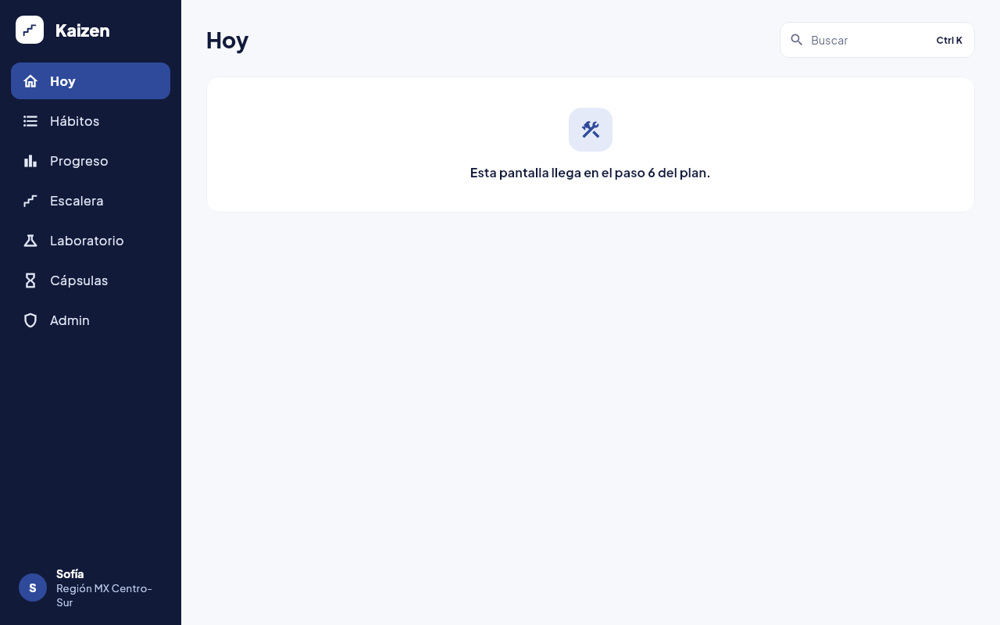
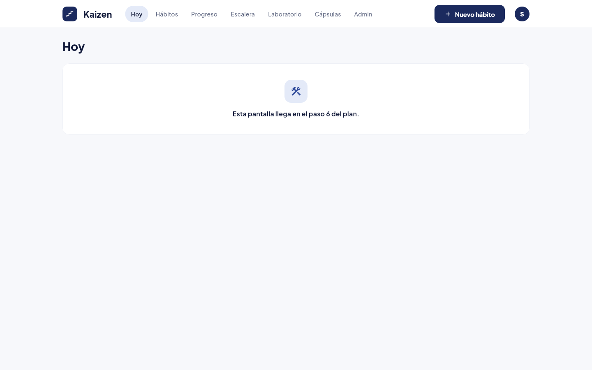

# Paso 3 · Navegación adaptativa (F1)

**Estado:** terminado · **Fecha:** 24-nov-2026 · **IA:** asistido (Claude), revisado por Samuel Rizo

Las rutas de toda la app, las guardas (sesión, rol y plataforma) y el marco de navegación que cambia según el ancho y
la plataforma: barra inferior, riel lateral o barra superior, como en los bosquejos. Cada ruta ya existe con una
**pantalla provisional** que dice en qué paso llega su contenido.

## Archivos

| Archivo | Qué contiene |
|---|---|
| `routing/rutas.dart` | `Rutas`: todas las rutas y los ayudantes (`Rutas.habito(id)`, `Rutas.nuevaCapsulaDe(id)`, `Rutas.loginDesde(ruta)`) |
| `routing/estado_sesion.dart` | `EstadoSesion` (lo escucha el router) y `UsuarioSesion` (nombre, rol, región) |
| `routing/guardas.dart` | `redirigir()`: las reglas de acceso; `destinoSeguro()`: evita redirecciones a otros sitios |
| `routing/router.dart` | `crearRouter()`: el `GoRouter` con el *shell* y las pantallas |
| `ui/core/adaptativo/plataforma.dart` | `Plataforma` (móvil, escritorio, web) y `PlataformaApp` para leerla en cualquier widget |
| `ui/core/adaptativo/breakpoints.dart` | `TamanoPantalla`: compacto < 600 · medio 600–1199 · amplio ≥ 1200 |
| `ui/core/adaptativo/destinos.dart` | Qué secciones hay en cada marco y cuál está elegida |
| `ui/core/adaptativo/shell_adaptativo.dart` | Elige el marco según el ancho y la plataforma |
| `ui/core/adaptativo/shell_movil.dart` | Barra inferior |
| `ui/core/adaptativo/shell_escritorio.dart` | Riel lateral (angosto o extendido) |
| `ui/core/adaptativo/shell_web.dart` | Barra superior |
| `ui/core/adaptativo/busqueda.dart` | Ctrl+K: paleta de búsqueda y campo "Buscar · Ctrl K" |
| `ui/core/widgets/encabezado_pantalla.dart` | Título, subtítulo y acciones de cada pantalla |
| `ui/core/widgets/avatar_usuario.dart` | Círculo con la inicial (abre el perfil) |
| `ui/provisional/pantallas_provisionales.dart` | Pantallas provisionales, entrada de prueba, restablecer y "página no encontrada" |

## Rutas

| Ruta | Pantalla | Llega en |
|---|---|---|
| `/login` | Entrar y crear cuenta | Paso 5 |
| `/restablecer?token=` | Nueva contraseña (enlace del correo) | Paso 5 |
| `/hoy` | Hoy | Paso 6 |
| `/habitos` · `/habitos/nuevo` · `/habitos/:id` · `/habitos/:id/editar` | Hábitos | Paso 7 |
| `/habitos/:id/escalera` · `/escalera` | Escalera Kaizen | Paso 9 |
| `/laboratorio` | Laboratorio | Paso 10 |
| `/capsulas` · `/capsulas/nueva?habito=` | Cápsula Kaizen | Paso 11 |
| `/progreso` · `/progreso/semana` | Progreso y Mi semana | Paso 12 |
| `/perfil` · `/perfil/privacidad` | Perfil y privacidad | Paso 13 |
| `/admin` · `/admin/indicadores` | Panel de administración e indicadores | Paso 14 |
| `/dev/componentes` | Galería de componentes (solo depuración) | Paso 2 |

En web, la ruta se ve en la barra de direcciones y se puede compartir (enlace profundo). Cambiar de sección no tiene
animación (`NoTransitionPage`), como en una app de escritorio.

## Guardas

`redirigir()` se evalúa antes de mostrar cada ruta y cada vez que cambia la sesión:

1. `/` → `/hoy`.
2. `/dev/*` solo existe en depuración (`kDebugMode`). En *release* lleva a `/hoy` o `/login`.
3. **Sin sesión** solo se abren `/login` y `/restablecer`. Cualquier otra ruta lleva a `/login?desde=<ruta>`, y después
   de entrar se regresa ahí (por ejemplo, un enlace a `/habitos/42/editar`).
4. **Con sesión**, `/login` lleva a `desde` o a `/hoy`. `desde` solo acepta rutas internas: `https://…`, `//sitio`,
   `javascript:` y `/\sitio` se ignoran, para que nadie arme un enlace de Kaizen que mande a otro sitio.
5. **`/admin/*`** exige el rol `admin` y **no existe en Android ni iOS**, ni siquiera para un admin (bosquejos 09 y
   10: solo escritorio y web). La API también lo valida: esto solo evita mostrar algo que no se puede usar.

`EstadoSesion` solo guarda el nombre, el rol y la región; **nunca los tokens**, que el Paso 4 guarda en el almacén
seguro. En el Paso 5 lo llena el login real con la respuesta de `POST /auth/login`. Mientras tanto, en depuración la
entrada provisional tiene **Entrar como usuario demo** y **Entrar como admin demo**. En *release* no aparecen.

## Marco de navegación

| Ancho | Móvil (Android, iOS) | Escritorio (Linux, Windows, macOS) | Web |
|---|---|---|---|
| < 600 | Barra inferior | Barra inferior | Barra inferior |
| 600–1199 | Riel angosto | Riel angosto | Riel angosto |
| ≥ 1200 | Riel extendido (tableta) | Riel extendido | **Barra superior** |

- **Barra inferior** (bosquejos móviles): Hoy · Hábitos · Progreso · Lab · Perfil. El elegido lleva una píldora
  `azul100`. La Escalera y las Cápsulas se abren desde Hoy y desde el detalle del hábito.
- **Riel** (bosquejos de escritorio): fondo `marino900`, logo, Hoy · Hábitos · Progreso · Escalera · Laboratorio ·
  Cápsulas · Admin (solo admin). El elegido va en `azul600`. Abajo está el usuario con su región, que abre el perfil.
  En la versión angosta, el nombre va debajo del ícono y abajo solo el avatar.
- **Barra superior** (bosquejos web): marca, secciones en píldoras, botón **Nuevo hábito** y avatar, centrados en
  1200 px.
- **Ctrl+K** (⌘K en Mac), en escritorio y web, abre una paleta que busca secciones sin importar mayúsculas ni
  acentos. Enter abre el primer resultado y Esc cierra. En escritorio amplio, el encabezado de cada pantalla trae
  además el campo "Buscar · Ctrl K" de los bosquejos. En el Paso 7 la búsqueda incluirá los hábitos.

| Móvil | Riel angosto | Escritorio | Web |
|---|---|---|---|
|  |  |  |  |

## Accesibilidad

- Cada barra se anuncia como "Menú principal" y cada sección como botón, con su estado de elegido.
- El área de toque de la barra inferior cumple la guía de Android (≥ 48 px). Hay una prueba que lo revisa.
- El título de cada pantalla está marcado como encabezado. El avatar se lee como "Abrir perfil de <nombre>".

## Pruebas

| Tipo | Archivos | Pruebas | Qué comprueba |
|---|---|---|---|
| Unitarias | `test/unit/routing/` (guardas, rutas y sesión), `test/unit/adaptativo/` | 27 nuevas (79 en total) | Cada regla de las guardas, incluidas 9 formas de redirección abierta; rutas con id codificado; la sesión avisa al router; breakpoints en los límites (599/600/1199/1200); plataforma por sistema; destinos por plataforma y rol; destino elegido en subrutas; filtro de búsqueda sin acentos |
| Widget | `test/widget/routing/` (navegación y búsqueda), `test/widget/app/` | 33 nuevas (94 en total) | En la app completa: sin sesión → entrar → Hoy; enlace profundo que vuelve después de entrar; usuario normal sin `/admin`; cierre de sesión; ruta inexistente; restablecer sin mostrar el token; galería solo en depuración; las 12 rutas del plan; **9 combinaciones de plataforma y ancho → marco correcto**; sin desbordes a 320 y 600 px; barra inferior, riel y barra superior; Admin solo para admin y nunca en móvil; Ctrl+K y ⌘K, Enter, Esc, sin resultados; campo Buscar solo en escritorio amplio |
| Golden | `test/golden/navegacion_golden_test.dart` | 5 nuevas (11 en total) | Los cuatro marcos y la entrada provisional |
| Integración | `integration_test/navegacion_test.dart` | 1 | En la app real de Linux: entrar → Hábitos → Ctrl+K "progreso" → Ctrl+K "perfil" → cerrar sesión |

**Resultado:** 184 de 184 en verde, más la de integración en Linux · `flutter analyze`: sin avisos ·
**cobertura: 99.5 %** (1275 de 1282 líneas). Compilan Linux, web y el APK.

## Cómo probarlo

```bash
cd app
flutter test                                              # todas
flutter test integration_test/navegacion_test.dart -d linux
flutter run -d linux  --dart-define=KAIZEN_FUENTE=fake    # "Entrar como usuario demo"; cambia el ancho de la ventana
flutter run -d chrome --dart-define=KAIZEN_FUENTE=fake    # prueba un enlace: http://localhost:<puerto>/#/habitos/42
```

Para ver los tres marcos, cambia el ancho de la ventana: menos de 600 px, entre 600 y 1199, y 1200 o más. Con
**Entrar como admin demo** aparece Admin en escritorio y web.
