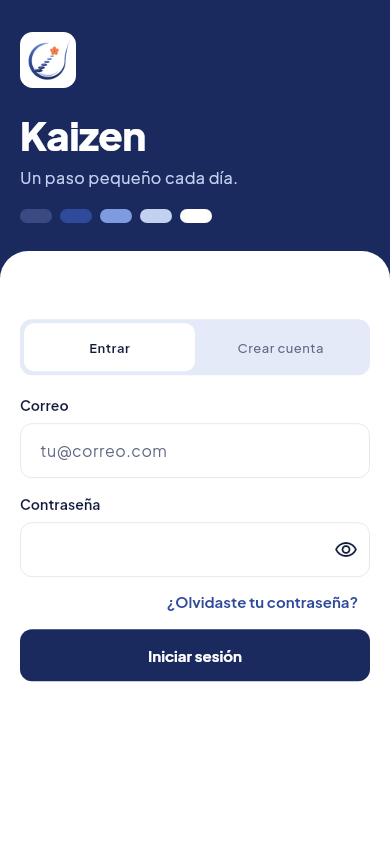
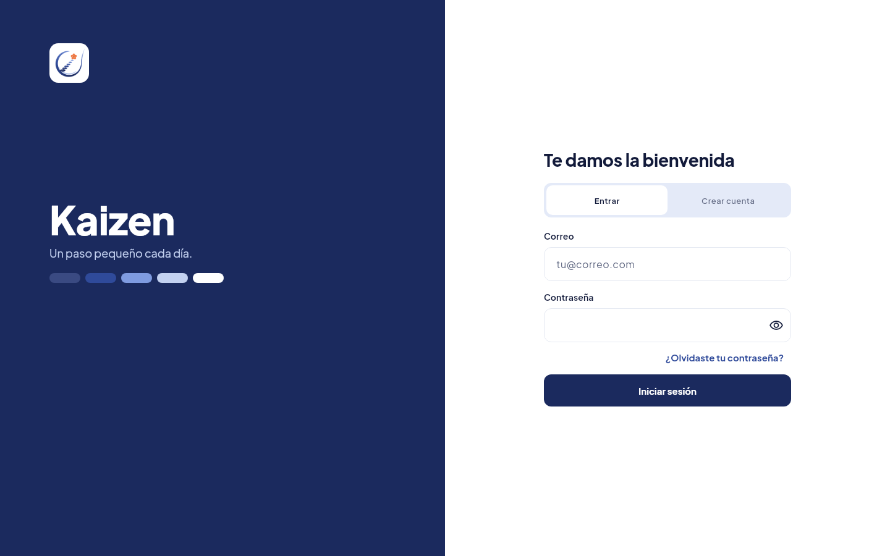

# Paso 5 · Módulo `auth` (bosquejo 01)

**Estado:** terminado · **Fecha:** 25-nov-2026 · **IA:** asistido (Claude), revisado por Samuel Rizo

La primera pantalla real de la app: entrar, crear cuenta, recuperar la contraseña y restablecerla con el enlace del
correo. Reemplaza la entrada provisional del Paso 3 (sus botones "Entrar como usuario demo" ya no existen). Al abrir la
app, la sesión guardada se restaura sola.

## Pantallas

| Ruta | Pantalla | Bosquejo |
|---|---|---|
| `/login` | `PantallaEntrar`: pestañas **Entrar** y **Crear cuenta** | 01 (móvil, escritorio y web) |
| — | `DialogoRecuperar`: "¿Olvidaste tu contraseña?" | — |
| `/restablecer?token=` | `PantallaRestablecer`: nueva contraseña con el enlace del correo | — |

- **Pantallas de 900 px o más:** panel `marino800` a la izquierda (logo, "Kaizen", lema y barra de 5 tonos) y el
  formulario a la derecha, con "Te damos la bienvenida".
- **Teléfono:** el panel de marca arriba y el formulario en una hoja blanca con esquinas redondeadas.
- **La región no se le muestra al usuario** (ni en la entrada, ni en el registro, ni en el riel): la base la asigna a
  partir del país y el estado (`fn_region`) y solo sirve para fragmentar los datos.

| Teléfono | Escritorio y web |
|---|---|
|  |  |

## Archivos

| Archivo | Qué hace |
|---|---|
| `data/services/servicio_sesion.dart` | `ServicioSesion`: entrar, registrar, salir y restaurar. Une `AuthRepository`, `GestorTokens` y `EstadoSesion` |
| `ui/auth/view_models/entrar_viewmodel.dart` | Comando `entrar` |
| `ui/auth/view_models/registro_viewmodel.dart` | País y estado, aviso obligatorio, consentimiento opcional y comando `registrar` |
| `ui/auth/view_models/recuperar_viewmodel.dart` | Comando `enviar` |
| `ui/auth/view_models/restablecer_viewmodel.dart` | Token del enlace y comando `guardar` |
| `ui/auth/widgets/pantalla_entrar.dart` | Diseño de dos paneles o de teléfono y pestañas |
| `ui/auth/widgets/panel_marca.dart` | Panel `marino800` de la marca |
| `ui/auth/widgets/formulario_entrar.dart` | Correo, contraseña, "¿Olvidaste…?", "Iniciar sesión" y atajos de cuentas de prueba |
| `ui/auth/widgets/formulario_registro.dart` | Campos del registro y aviso de privacidad |
| `ui/auth/widgets/dialogo_recuperar.dart` | Recuperar la contraseña |
| `ui/auth/widgets/pantalla_restablecer.dart` | Restablecer la contraseña |
| `ui/core/mensajes.dart` | Texto de **cada** error del contrato y de cada validación |
| `ui/core/widgets/mensaje_error.dart` | Error dentro de un formulario (se anuncia al lector de pantalla) |

## Endpoints del contrato

| Acción | Endpoint | Qué pasa después |
|---|---|---|
| Entrar | `POST /auth/login` | Se guardan los tokens; el router lleva a `/hoy` o a la ruta de `?desde=` |
| Crear cuenta | `POST /auth/registro` | Igual: la cuenta queda con la sesión abierta |
| Abrir la app | `POST /auth/renovar` | Si había sesión guardada, se renueva antes de la primera pantalla |
| Cerrar sesión | `POST /auth/salir` | Se borran los tokens **aunque el servidor no responda** |
| ¿Olvidaste…? | `POST /auth/recuperar` | Siempre el mismo mensaje |
| Restablecer | `POST /auth/restablecer` | Mensaje de éxito; las sesiones se cierran |

## Reglas

- **Entrar:** valida el formato del correo y que la contraseña no esté vacía antes de llamar a la API. El mismo
  mensaje "Correo o contraseña incorrectos." sale exista o no la cuenta.
- **Crear cuenta:**
  - nombre de 1 a 80 caracteres;
  - correo válido;
  - contraseña de **18 a 128** caracteres y distinta del correo (acordado con backend; contrato v1.5);
  - país de la lista de `paises_estados.json` (México primero);
  - **el estado solo se pide en México**: al elegir otro país, se borra;
  - el **aviso de privacidad es obligatorio** y se puede leer en un diálogo;
  - el consentimiento de señales es **opcional y aparte**, y por omisión está apagado.
- **Errores del servidor:** los errores por campo de un 422 (por ejemplo, "contraseña en la lista de comunes") se
  muestran **junto al campo**. Un correo ya registrado da el mensaje genérico "No fue posible completar el registro."
  para no revelar qué correos existen.
- **Errores del contrato:**
  - cuenta suspendida (403);
  - cuenta bloqueada (429, con los minutos de `Retry-After`);
  - límite de tasa;
  - sin conexión;
  - servicio no disponible.
- **Recuperar:** siempre "Si el correo está registrado, te enviamos un enlace…". Solo los errores de red o de límite
  de tasa se muestran como error.
- **Restablecer:** sin token o con un token usado o vencido, dice "El enlace no es válido o ya venció" y ofrece
  **pedir otro enlace**. Valida la longitud y la confirmación. **Nunca muestra el token.**
- **Restaurar al abrir:** si hay un token de renovación guardado, se renueva (máximo 4 s):
  - **sin red**, la app abre con el usuario guardado y funciona sin conexión;
  - si el servidor **rechaza** el token (contraseña cambiada, sesión revocada, cuenta suspendida), lo borra y muestra
    la entrada.
- Si durante el uso una renovación falla por sesión inválida, la sesión se cierra sola.
- **Cuentas de prueba:** solo con `KAIZEN_FUENTE=fake` y en depuración, unos atajos llenan correo y contraseña de
  las cuentas del poblador (Daniela, Admin, Lucía, Nico y Suspendido). En *release* no aparecen.
- **Accesibilidad:** las pruebas encontraron dos problemas reales y quedaron corregidos:
  - los segmentos del selector "Entrar | Crear cuenta" medían 40 px y ahora miden **48 px** (área de toque mínima
    de Android); el cambio se hizo en el componente del Paso 2, así que se regeneró la imagen golden
    `controles_formulario`;
  - en el teléfono, la hoja blanca ocultaba el efecto al tocar las casillas, así que ahora es un `Material`.

## Logo nuevo

En este paso se cambió el logo por el **ensō** (ver `02_sistema_de_diseno.md`, sección "Logo"): `LogoKaizen` ahora
muestra `assets/imagenes/logo_kaizen.png` y se regeneraron los íconos de la app en Android, iOS, macOS, web y Windows.
Los colores del manifiesto web pasaron al marino de la app.

## Pruebas

| Tipo | Archivo | Pruebas | Qué comprueba |
|---|---|---|---|
| Unitarias | `test/unit/auth/sesion_y_viewmodels_test.dart` | 20 | `ServicioSesion` (entrar, error sin guardar nada, registrar, salir sin red, restaurar en sus 4 casos, cierre automático por cuenta suspendida); ViewModels (cada error del login, México primero, estado solo en México, aviso obligatorio, consentimiento aparte, correo repetido); recuperar igual exista o no; restablecer de un solo uso; cada `TipoError` y cada validación con texto; minutos del bloqueo; código de petición en un 500 |
| Widget | `test/widget/auth/pantalla_entrar_test.dart` | 17 | Diseño de teléfono y de dos paneles, sin desbordes a 320 px y guías de accesibilidad; validación antes de la API; credenciales (mismo mensaje), suspendida, bloqueada, sin red; éxito a Hoy (teléfono) y al riel con su nombre (escritorio); atajos solo en depuración; recuperar (mismo mensaje, usa el correo ya escrito, errores, cancelar); registro (estado solo en México y la región nunca visible, aviso obligatorio, contraseña de menos de 18, aviso en diálogo, éxito, correo repetido, error del servidor junto al campo); con sesión, `/login` lleva a Hoy |
| Widget | `test/widget/auth/pantalla_restablecer_test.dart` | 5 | Sin token, validaciones, éxito y entrar con la nueva, enlace usado, error del servidor en el campo |
| Golden | `test/golden/navegacion_golden_test.dart` | 2 (reemplazan a la entrada provisional) | Pantalla de entrada en teléfono y en web |
| Integración | `integration_test/auth_test.dart` | 1 | En la app real de Linux: crear cuenta (Argentina → LATAM) → Hoy → Ctrl+K "perfil" → cerrar sesión (**tokens borrados del almacén**) → entrar con la cuenta nueva |

También se actualizaron las pruebas del Paso 3 para que entren con el formulario real (`entrarCon` en
`test/helpers/app.dart`).

**Resultado:** 336 de 336 en verde, más las 2 de integración en Linux · `flutter analyze`: sin avisos ·
**cobertura: 99.0 %**; el módulo `auth` está al 97–100 %. Compilan Linux, web y el APK.

> En escritorio, los archivos de `integration_test/` se corren **uno por uno**. Si se corren todos juntos, Flutter
> a veces no logra conectarse con la segunda app ("Unable to start the app on the device").

## Cómo probarlo

```bash
cd app
flutter test
flutter test integration_test/auth_test.dart -d linux
flutter test integration_test/navegacion_test.dart -d linux
flutter run -d linux --dart-define=KAIZEN_FUENTE=fake
```

En la app, con *fakes* (contraseña de las cuentas de prueba: `KaizenDemo2026!`):
1. Toca **Daniela** e **Iniciar sesión**.
2. Prueba una contraseña incorrecta y la cuenta **Suspendido**.
3. En **Crear cuenta**, elige México y luego otro país: el estado aparece y desaparece. Intenta crearla sin aceptar
   el aviso.
4. En **¿Olvidaste tu contraseña?**, con `demo@kaizen.test`, el enlace sale en la consola
   (`[Kaizen · fake] Enlace…`). Ábrelo en `-d chrome` como `/#/restablecer?token=…`.

Contra la API local de Angel: `--dart-define=KAIZEN_FUENTE=api --dart-define=API_BASE_URL=http://localhost:8000/api/v1`,
con las mismas cuentas del poblador.
