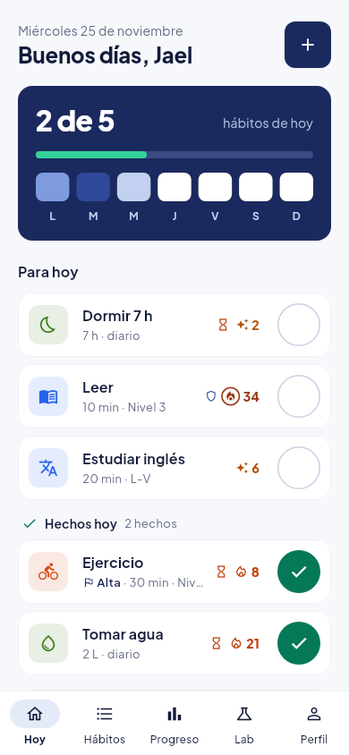
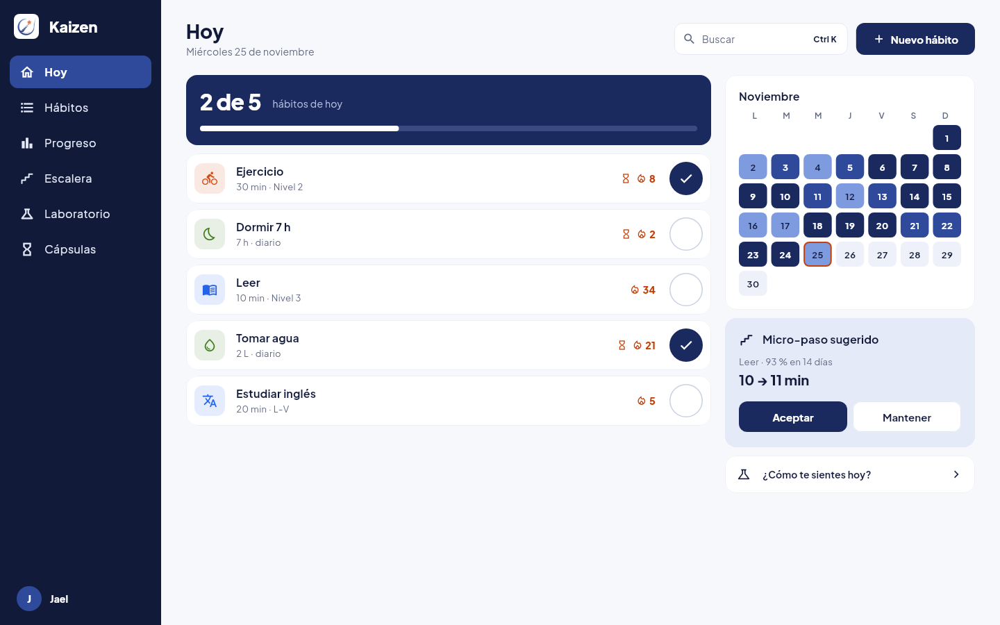
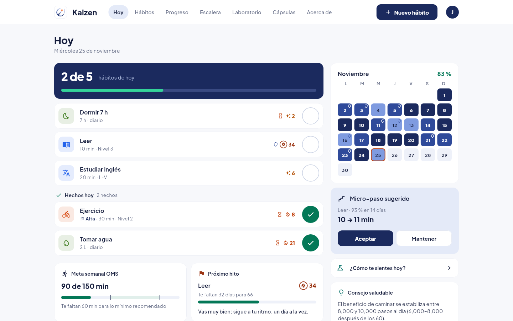

# Paso 6 · Módulo `hoy` (bosquejo 02)

**Estado:** terminado · **Fecha:** 25-nov-2026 · **IA:** asistido (Claude), revisado por Samuel Rizo

La pantalla principal de la app: qué hábitos tocan hoy, el **check-in de un toque**, cuántos van ("2 de 5"), cómo va
la semana o el mes, la sugerencia de la Escalera Kaizen y el acceso a "¿Cómo te sientes hoy?". Reemplaza la pantalla
provisional de `/hoy` del Paso 3. La vista "Mi semana" del teléfono (bosquejo móvil 09) llega con Progreso, en el
Paso 12.

## Pantallas

| Ruta | Pantalla | Bosquejo |
|---|---|---|
| `/hoy` | `PantallaHoy` | 02 (móvil, escritorio y web) |
| — | Hoja "Micro-paso sugerido" (teléfono) | 02 móvil (al tocar la sugerencia) |

- **Teléfono (contenido de menos de 900 px):** fecha y saludo ("Buenos días, Daniela"), botón **+** (nuevo hábito),
  tarjeta **"2 de 5"** con su barra y la **semana L–D** coloreada por cumplimiento, lista **Para hoy**, la sugerencia
  de la Escalera ("Leer: ¿subir de 10 a 11 min?") y "¿Cómo te sientes hoy?".
- **Escritorio y web (900 px o más):** título "Hoy" con la fecha y dos columnas: a la izquierda la tarjeta "2 de 5" y
  los hábitos; a la derecha el **calendario del mes** con la intensidad de cada día, el **Micro-paso sugerido** con
  **Aceptar** y **Mantener** a la vista y "¿Cómo te sientes hoy?".
  - En escritorio, el botón **Nuevo hábito** va en el encabezado; en web ya está en la barra superior, así que no se
    repite.
  - Con el riel angosto (600–1199 px de ventana) el contenido queda por debajo de 900 px y se usa el diseño de una
    columna.

| Teléfono | Escritorio | Web |
|---|---|---|
|  |  |  |

## Archivos

| Archivo | Qué hace |
|---|---|
| `ui/hoy/view_models/hoy_viewmodel.dart` | `HoyViewModel`: carga, "N de M", semana y mes, check-in optimista, responder la sugerencia |
| `ui/hoy/widgets/pantalla_hoy.dart` | Diseño de una o dos columnas, avisos (*snackbars*) y navegación |
| `ui/hoy/widgets/tarjetas_hoy.dart` | `TarjetaProgresoDia` ("2 de 5"), `TarjetaSugerencia` (teléfono), `TarjetaMicroPaso` y `BotonesSugerencia` (escritorio y hoja), `TarjetaSenal` |
| `ui/core/formatos.dart` | Textos compartidos: frecuencia ("diario", "L-V", "S-D", "L, Mi, V", "3 por semana"), subtítulo del hábito ("2 L · diario", "10 min · Nivel 3") y saludo por hora. Los usará también Hábitos (Paso 7) |
| `utils/intensidad.dart` | Porcentaje → nivel 0–4 de color (0 · <35 · <70 · <100 · 100 %) |
| `utils/reloj.dart` | `Reloj`: de dónde sale "ahora". La app usa el del dispositivo; las pruebas fijan uno |

Cambios en archivos de pasos anteriores:
- `config/dependencias.dart` registra `Provider<Reloj>` (ahora son 14 proveedores). Con *fakes* es el mismo reloj de
  `DatosDemo`, así "hoy" coincide en la app y en el servidor en memoria.
- `data/fake/datos_demo.dart` expone ese reloj (`reloj`).
- `routing/router.dart`: `/hoy` abre `PantallaHoy`.
- `l10n/app_es.arb`: 27 textos nuevos de Hoy.

## Endpoints del contrato

| Qué | Endpoint | Notas |
|---|---|---|
| Hábitos de hoy | `GET /habitos?fecha=` | Cada hábito trae `hoy` (programado, cumplido y el check-in de hoy) y su racha. **Es lo único indispensable** |
| Semana L–D | `GET /progreso?periodo=semana&fecha=` | `por_dia[].cumplimiento` → color de cada día |
| Calendario del mes | `GET /progreso?periodo=mes&fecha=` | Igual, del 1 a hoy |
| Sugerencia | `GET /escalera/sugerencias` | Se muestra la primera **pendiente** |
| Reloj de arena | `GET /capsulas?estado=sellada` | Hábitos con cápsula sellada |
| Check-in | `POST /registros` | `origen: rapido`, `id` UUID generado en la app |
| Aceptar o Mantener | `POST /escalera/sugerencias/{id}/respuesta` | `aceptar: true/false` |

Las cinco lecturas van **en paralelo**. Si falla una que no es la de hábitos, la pantalla se muestra igual sin esa
parte (por ejemplo, sin sugerencia o con la semana en blanco). Si fallan los hábitos, sale el error con **Reintentar**.
Deslizar hacia abajo recarga todo.

## Reglas

- **"N de M" cuenta solo los hábitos programados hoy** (`hoy.programado`). Los de "N por semana" se listan en
  "Para hoy" (se pueden cumplir cualquier día) pero no cuentan en el total. Un hábito L-V no aparece en sábado.
- **"Hoy" es el día del usuario**, no el de UTC: a las 23:50 del miércoles sigue siendo miércoles aunque en UTC ya sea
  jueves. El servidor hace lo mismo con `X-Zona-Horaria`.
- **Check-in de un toque (optimista):**
  - al tocar el círculo, la fila se marca, "N de M" cambia y la racha sube (o baja al desmarcar) **al instante**;
  - después se usa la racha que confirma el servidor (`racha_actual` de la respuesta);
  - si el servidor lo **rechaza**, la fila **vuelve a como estaba** y sale "No se guardó el check-in de Leer: …";
    **sin red** (desde el Paso 8) el check-in se queda marcado y en la cola sin conexión (ver `08_sin_conexion.md`);
  - un segundo toque mientras se envía se ignora;
  - el `id` del check-in es un UUID hecho en la app y se **reusa** si ya hay check-in de hoy: marcar, desmarcar y
    volver a marcar deja **un solo** registro (idempotente, como pide el contrato). Esto es lo que permitirá
    reenviarlo sin duplicar en el modo sin conexión (Paso 8);
  - la semana y el mes se recargan después de cada check-in, sin bloquear la pantalla.
- **Sugerencia de la Escalera:**
  - en el teléfono es un renglón que abre una hoja con **Aceptar** y **Mantener**; en escritorio están a la vista;
  - **Aceptar** sube el nivel y la meta ("Subiste al nivel 4: tu nueva meta es 11 min.") y la lista se recarga;
  - **Mantener** deja la meta igual ("Mantienes tu meta actual.");
  - si ya estaba resuelta en otro dispositivo (409 `sugerencia-resuelta`) también se quita; con otro error se avisa
    y la sugerencia se queda para reintentar.
- **Subtítulo de cada hábito:** meta, unidad y frecuencia ("2 L · diario", "20 min · L-V"); si ya subió de nivel con
  la Escalera, el nivel en lugar de la frecuencia ("10 min · Nivel 3"), como en el bosquejo.
- **Saludo:** "Buenos días" de 5 a 12 h, "Buenas tardes" de 12 a 19 h y "Buenas noches" el resto; con el primer
  nombre.
- **Sin hábitos:** "Aún no tienes hábitos" con el botón **Crear mi primer hábito**. Si hay hábitos pero ninguno toca
  hoy: "Hoy no tienes hábitos programados. ¡Descansa!".
- **Accesibilidad:** la tarjeta "2 de 5" se lee completa ("Hoy: 2 de 5 hábitos cumplidos"); el saludo y "Para hoy"
  son encabezados; cada check ya decía "Marcar Leer como cumplido" desde el Paso 2.
- Tocar un hábito abre su detalle (Paso 7); "¿Cómo te sientes hoy?" abre el Laboratorio (Paso 10).

### Correcciones de pasos anteriores

- El **botón +** del teléfono se veía oscuro sobre marino: el tema pinta todos los `IconButton` con el color del
  texto, también los rellenos. Este botón ahora fija el "+" en blanco.
- **Goldens estables:** las pruebas de la app completa usan un reloj fijo (miércoles 25-nov-2026, 9:30) y precargan
  el logo. Antes, la fecha y el saludo cambiaban cada día, y el logo a veces salía vacío porque la imagen se
  decodifica fuera del reloj de la prueba. Por eso se regeneraron las cuatro imágenes `shell_*`.

## Pruebas

| Tipo | Archivo | Pruebas | Qué comprueba |
|---|---|---|---|
| Unitarias | `test/unit/hoy/hoy_viewmodel_test.dart` | 19 | "2 de 5" de Daniela con sugerencia y cápsulas; semana L–D (días futuros en `null`) y mes sin días futuros; "N por semana" listado pero no contado; L-V no aparece en sábado; si fallan los hábitos falla la carga; si fallan sugerencia o progreso, la pantalla sale igual; check-in optimista (racha al instante, luego la del servidor); desmarcar reusa el `id`; error → vuelve a como estaba; marcar–desmarcar–marcar deja **un** registro; doble toque ignorado; semana y mes se refrescan; aceptar sube nivel y meta; mantener; 409 resuelta; otro error deja la sugerencia; "hoy" local a las 23:50 |
| Unitarias | `test/unit/hoy/formatos_test.dart` | 5 | Frecuencia en palabras, subtítulo del hábito, saludo por hora, intensidad 0–4 con sus bordes, reloj del sistema |
| Widget | `test/widget/hoy/pantalla_hoy_test.dart` | 16 | Teléfono: saludo, fecha, "2 de 5", semana, filas, sugerencia y señal; lectura del lector de pantalla; check-in sube la racha; check-in fallido avisa y revierte; hoja de sugerencia y Aceptar; +, fila y señal navegan; estado vacío (Nico); error con Reintentar. Escritorio y web: dos columnas con calendario y micro-paso; Mantener; check-in; en web "Nuevo hábito" una sola vez; riel angosto usa una columna |
| Golden | `test/golden/hoy_golden_test.dart` | 3 | Hoy en teléfono, escritorio y web con los datos de Daniela |
| Integración | `integration_test/hoy_test.dart` | 1 | En la app real de Linux: entrar como Daniela → marcar Leer → "3 de 5" y racha +1 → abrir la app de nuevo y entrar: el check-in sigue → desmarcar → la racha vuelve |

También se actualizaron las pruebas que esperaban la pantalla provisional de Hoy (`navegacion_test.dart` de widget e
integración, y `auth_test.dart` de integración: una cuenta nueva ahora llega a "Aún no tienes hábitos").

**Resultado:** 379 de 379 en verde, más las 3 de integración en Linux · `flutter analyze`: sin avisos ·
**cobertura: 99.2 %**; `hoy_viewmodel` 100 %, `formatos` 100 %, `tarjetas_hoy` 98.8 %, `pantalla_hoy` 95.6 %.

## Cómo probarlo

```bash
cd app
flutter test
flutter test integration_test/hoy_test.dart -d linux
flutter run -d linux --dart-define=KAIZEN_FUENTE=fake
```

En la app, con *fakes* (contraseña de las cuentas de prueba: `KaizenDemo2026!`):
1. Entra como **Daniela**: "2 de 5", Tomar agua y Ejercicio ya cumplidos, reloj de arena en los que tienen cápsula.
2. Marca **Leer**: "3 de 5" y su racha sube de 34 a 35. Desmárcalo y vuelve.
3. Toca la sugerencia (teléfono) o **Aceptar** (escritorio): Leer pasa a 11 min y sube de nivel.
4. Entra como **Nico (nuevo)**: estado vacío con "Crear mi primer hábito".
5. Entra como **Lucía (LATAM)**: "Ahorrar" (3 por semana) aparece en la lista pero no cuenta en "N de M".
