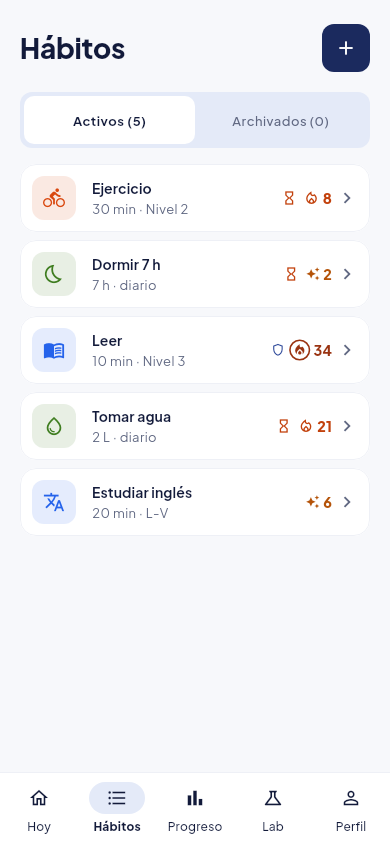
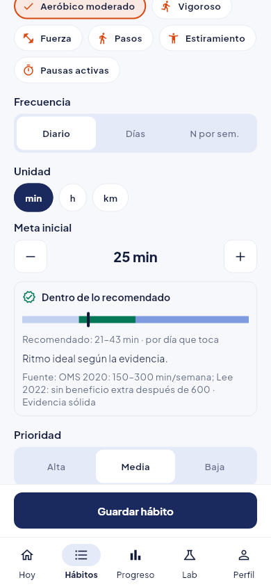
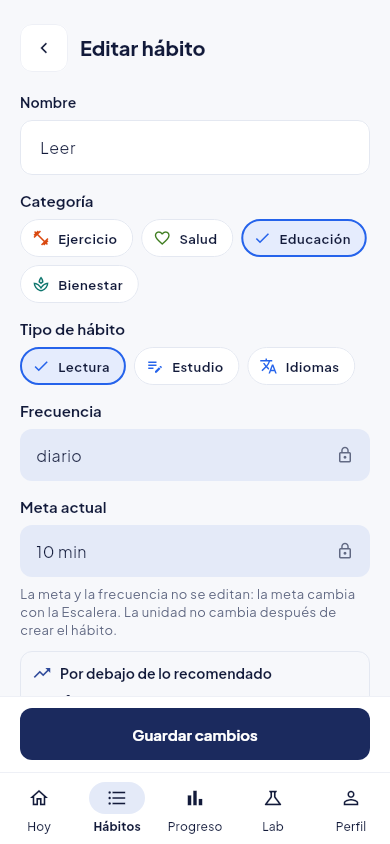
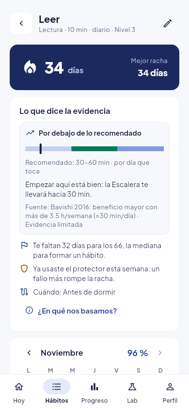
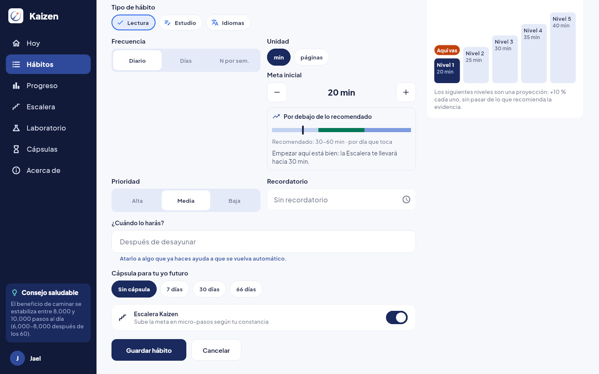
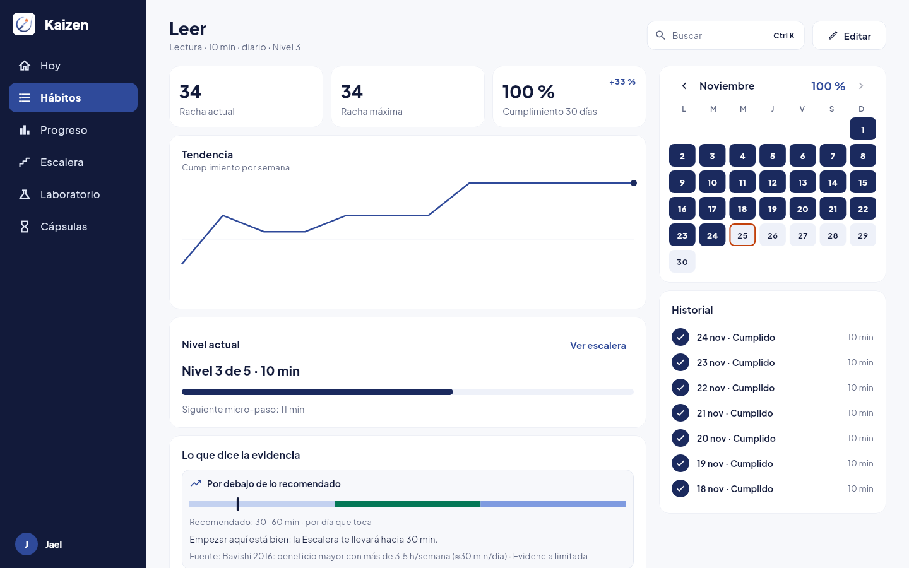

# Paso 7 · Módulo `habitos` (bosquejos 03 y 04)

**Estado:** terminado · **Fecha:** 27-nov-2026 (rehecho con respaldo científico, contrato v1.6) · **IA:** asistido
(Claude), revisado por Samuel Rizo

Todo lo de un hábito: la lista, crearlo, editarlo, archivarlo o reactivarlo, verlo en detalle (racha, calendario,
historial y tendencia) y su **recordatorio** local en el teléfono. Reemplaza las cuatro pantallas provisionales de
`/habitos` del Paso 3.

Desde el contrato v1.6 cada hábito pertenece a una **subcategoría** con unidades permitidas y un **rango que
recomienda la evidencia**. El formulario y el detalle dicen dónde cae la meta (baja, en el óptimo, alta o excesiva),
con su fuente. También se agregan la **prioridad**, la **intención** "Después de ___", el **protector de racha** y
cápsulas de **7, 30 y 66** días. Ver "Respaldo científico".

## Pantallas

| Ruta | Pantalla | Bosquejo |
|---|---|---|
| `/habitos` | `PantallaHabitos`: pestañas **Activos** y **Archivados** | — (no hay bosquejo; sigue el estilo de las filas de Hoy) |
| `/habitos/nuevo` | `PantallaFormularioHabito` (crear) | 03 (móvil, escritorio y web) |
| `/habitos/:id/editar` | `PantallaFormularioHabito` (editar y archivar) | 03 |
| `/habitos/:id` | `PantallaDetalleHabito` | 04 (móvil, escritorio y web) |

- **Teléfono:** encabezado con el botón "‹" cuadrado de los bosquejos.
  - El formulario es una sola columna con **Guardar hábito** fijo abajo.
  - El detalle muestra racha, calendario e historial.
- **Escritorio y web (900 px o más de contenido):**
  - El formulario lleva a la derecha **Así se verá** (la fila tal como saldrá en Hoy) y **Tu escalera inicial** (el
    nivel 1, "Aquí vas", y 4 niveles proyectados a +10 % cada uno).
  - El detalle agrega 3 KPI (racha actual, racha máxima, cumplimiento de 30 días con su variación), la **tendencia**
    por semana (`fl_chart`) y el **nivel actual** ("Nivel 3 de 5 · 10 min", siguiente micro-paso y "Ver escalera").
- **Diferencias con los bosquejos:**
  - En escritorio, la categoría se elige con chips, igual que en el teléfono, y no con un campo con "›".
  - El segmento de frecuencia dice **Días** en lugar de "L-V": al elegirlo aparecen los 7 días (L-V por omisión)
    y se pueden cambiar.
  - Hay un campo **Unidad**, que los bosquejos no muestran pero el contrato pide.
  - En el teléfono, la barra inferior sigue visible en el formulario.

| Lista | Nuevo (teléfono) | Editar | Detalle (teléfono) |
|---|---|---|---|
|  |  |  |  |

| Nuevo hábito (escritorio) | Detalle (escritorio) |
|---|---|
|  |  |

## Respaldo científico (contrato v1.6)

Las reglas y los números vienen de la base (`referencia_cientifica`, `fn_evaluar_meta`); la app los usa tal cual.

| Qué | Cómo funciona en la app |
|---|---|
| **Catálogo** | `GET /categorias` devuelve 5 categorías (con `clave`, `color` e `icono`) y 22 subcategorías, cada una con sus **unidades permitidas** (factor a la unidad base, paso, mínimo y máximo de captura) y su **referencia** (óptimo, máximo, piso, cita, fuentes F##, confianza). El ícono y el color salen del catálogo, ya no se adivinan por el nombre |
| **Evaluación** | `EvaluadorEvidencia.evaluar` (`utils/evidencia.dart`) es un espejo exacto de `fn_evaluar_meta`: convierte la meta a la unidad base (y a la semana si la referencia es semanal) y devuelve la zona, el rango **por sesión** en la unidad del hábito y la meta sugerida. Así funciona sin red; las pruebas repiten los casos de las pruebas SQL |
| **Formulario** | Categoría (chips con su color e ícono) → subcategoría → unidad (solo las permitidas) → meta, que **arranca en el inicio de lo recomendado** (en `reducir`, en el límite) y sube al paso de la unidad. Debajo, "Lo que dice la evidencia" (`PanelEvidencia`): zona con ícono y texto, barra del rango, qué hacer, fuente y confianza. Si la meta pasa del máximo, el botón **Usar X** pone el tope (sin bloquear: se puede guardar igual y la Escalera propondrá bajar) |
| **Prioridad** | Alta, media (por omisión) o baja. La lista y Hoy llegan ordenadas por prioridad y después por nombre, como `GET /habitos` |
| **Intención** | "¿Cuándo lo harás?" (opcional, hasta 120 caracteres). El recordatorio la usa como texto: "Después de desayunar: Tomar agua" |
| **Escalera inicial** | Proyecta como la Escalera v2: +10 % al paso de la unidad (al menos un paso, como mucho +30 %) **sin pasar del fin del óptimo**. Si la meta ya está en el óptimo o arriba, no proyecta: "Ritmo ideal" |
| **Detalle** | `TarjetaEvidenciaHabito`: la zona con su fuente, "Te faltan N días para los 66" o **Hábito formado** (66 días, la mediana científica), el protector de la semana y la intención. "Nivel N de M" ya no inventa niveles más allá del óptimo |
| **Editar** | La unidad queda fija como la meta (cambiarla sin cambiar la meta le quitaría sentido). La subcategoría solo puede cambiar a una que acepte la misma unidad. No hay "Usar X": la meta solo cambia con la Escalera |
| **Cápsula** | 7, 30 o 66 días (el 21 no tiene sustento) |
| **Errores nuevos** | `subcategoria-inactiva` (KZ017) y `unidad-no-permitida` (KZ016): se recarga el catálogo y se quita la elección |
| **Racha (modo *fake*)** | `DatosDemo.racha` aplica el **protector** como `fn_rachas`: el primer día programado fallado de cada semana no rompe la racha. Para que las rachas de demo sigan siendo las de los bosquejos (21, 8, 34…), la siembra pone dos fallos en la misma semana antes de cada racha |

### Catálogo del modo *fake*

`data/fake/catalogo_demo.dart` es el JSON de `GET /categorias` generado desde la base (mismos ids que el clúster):

```sql
SELECT jsonb_agg(jsonb_build_object('id', c.id, 'clave', c.clave, 'nombre', c.nombre, 'color', c.color,
         'icono', c.icono, 'subcategorias', (SELECT jsonb_agg(jsonb_build_object('id', s.id, 'clave', s.clave,
           'nombre', s.nombre, 'icono', s.icono, 'sentido', s.sentido,
           'unidades', (SELECT jsonb_agg(to_jsonb(u) - 'subcategoria_id' - 'orden' ORDER BY u.orden)
                          FROM kaizen.unidad_subcategoria u WHERE u.subcategoria_id = s.id),
           'referencia', (SELECT to_jsonb(r) - 'id' - 'subcategoria_id' - 'actualizada_en'
                            FROM kaizen.referencia_cientifica r WHERE r.subcategoria_id = s.id)) ORDER BY s.orden)
           FROM kaizen.subcategoria s WHERE s.categoria_id = c.id AND s.activa)) ORDER BY c.orden)
  FROM kaizen.categoria c WHERE c.activa;
```

Si el catálogo cambia en la base, se vuelve a generar; `test/unit/evidencia/catalogo_test.dart` comprueba que cada
ícono se pueda dibujar y que cada color cumpla el contraste.

## Archivos

| Archivo | Qué hace |
|---|---|
| `ui/habitos/view_models/habitos_viewmodel.dart` | Lista: activos y archivados (una llamada con `archivados=true`), por prioridad y nombre |
| `ui/habitos/view_models/formulario_habito_viewmodel.dart` | Crear y editar: categoría → subcategoría → unidad, meta inicial recomendada, evaluación en vivo y "Usar X", prioridad, intención, validación, `NuevoHabito` / `CambiosHabito`, recordatorio y archivar |
| `utils/evidencia.dart` | `EvaluadorEvidencia`: espejo de `fn_evaluar_meta` (zona, rango por sesión, meta sugerida, piso), sesiones por semana, redondeo al paso y meta inicial |
| `domain/models/evidencia.dart` | `ZonaEvidencia` y `Evaluacion` |
| `data/fake/catalogo_demo.dart` | Catálogo de la base (generado) para el modo *fake* |
| `ui/core/apariencia_habito.dart` | Ícono (de la subcategoría) y color (de la categoría) de un hábito |
| `ui/habitos/widgets/chips_con_icono.dart` | Chips de categoría y subcategoría con ícono y color |
| `ui/habitos/widgets/panel_evidencia.dart` | "Lo que dice la evidencia" y la barra del rango |
| `ui/habitos/widgets/tarjeta_evidencia_habito.dart` | Tarjeta del detalle: evidencia, 66 días, protector e intención |
| `ui/habitos/view_models/detalle_habito_viewmodel.dart` | Detalle: hábito, un año de check-ins, Escalera, meses, porcentajes, tendencia, historial y reactivar |
| `ui/habitos/view_models/estadisticas_habito.dart` | Funciones puras: cumplimiento de un periodo, intensidad del calendario, tendencia semanal, proyección +10 % y proyección con tope de la evidencia |
| `ui/habitos/widgets/pantalla_habitos.dart` | Lista y `FilaHabitoLista` |
| `ui/habitos/widgets/pantalla_formulario_habito.dart` | Formulario de una o dos columnas |
| `ui/habitos/widgets/vista_previa_habito.dart` | "Así se verá" y `EscaleraInicial` |
| `ui/habitos/widgets/pantalla_detalle_habito.dart` | Detalle de una o dos columnas y aviso de archivado |
| `ui/habitos/widgets/tarjetas_detalle.dart` | `TarjetaRacha`, `TarjetaCalendarioHabito`, `TarjetaHistorial`, `TarjetaTendencia`, `TarjetaNivel` |
| `data/services/recordatorios/servicio_recordatorios.dart` | Interfaz de recordatorios y versión en memoria (pruebas, escritorio y web) |
| `data/services/recordatorios/servicio_recordatorios_local.dart` | Notificaciones locales con `flutter_local_notifications` + `timezone` (Android e iOS) |
| `ui/core/widgets/boton_volver.dart` | `BotonVolver` y `EncabezadoInterno` (pantallas internas en el teléfono) |
| `ui/core/adaptativo/recarga_al_volver.dart` | `RecargaAlVolver`: recarga una pantalla cuando su ruta vuelve a ser la actual |

Cambios en archivos de pasos anteriores:
- `config/dependencias.dart` registra `ServicioRecordatorios` (ahora son 15 proveedores): notificaciones locales en
  Android e iOS y versión en memoria sin recordatorios en escritorio y web. Las pruebas usan la versión en memoria.
- `android/app/src/main/AndroidManifest.xml`: permiso `RECEIVE_BOOT_COMPLETED` y los dos *receivers* del *plugin*
  (para que los recordatorios sobrevivan a un reinicio).
- `routing/router.dart`: las cuatro rutas de hábitos abren las pantallas reales.
- `routing/rutas.dart`: `nuevaCapsulaDe(id, objetivo: 21)` agrega `&objetivo=` para la pantalla de cápsula.
- `utils/fechas.dart`: `Fechas.corta` ("7 nov").
- `ui/core/tema/iconos.dart`: íconos de editar, archivar, reactivar y recordatorio.
- `ui/hoy/widgets/pantalla_hoy.dart`: usa `RecargaAlVolver` (ver "Corrección").
- `l10n/app_es.arb`: 72 textos nuevos, más 41 del respaldo científico.
- Contrato v1.6 en modelos y datos de prueba: `domain/models/categoria.dart` (árbol con subcategorías, unidades y
  referencia), `habito.dart` (subcategoría, prioridad, intención, evaluación, racha protegida; `NuevoHabito` con
  `subcategoria_id`; `CambiosHabito` sin `categoria_id`), `escalera.dart` (motivo y cita de la sugerencia;
  `cumplimiento_14d` puede ser `null`), `errores_api.dart` y `mensajes.dart` (KZ016, KZ017), `validadores.dart`
  (intención), `config/constantes.dart` (cápsulas 7/30/66), `data/fake/datos_demo.dart` y los repositorios *fake* de
  categorías y hábitos.
- `ui/core/tema/iconos.dart` (íconos por nombre del catálogo), `ui/core/tema/colores.dart` (`verdeProgreso`, color de
  categoría y su fondo), `ui/core/widgets/fila_habito.dart` (color de la categoría en el ícono),
  `ui/hoy/widgets/pantalla_hoy.dart` y `tarjetas_hoy.dart` (ícono y color del hábito; sugerencia por exceso sin %).

## Endpoints del contrato

| Qué | Endpoint | Notas |
|---|---|---|
| Lista | `GET /habitos?fecha=&archivados=true` | Activos y archivados en una llamada, por prioridad y nombre, con `evaluacion` |
| Categorías | `GET /categorias` | Árbol activo con subcategorías, unidades y referencia (v1.6) |
| Crear | `POST /habitos` | Con `subcategoria_id`, `prioridad` e `intencion`. 201 con nivel 1; 422 `subcategoria-inactiva` / `unidad-no-permitida` / `validacion` |
| Editar / archivar / reactivar | `PATCH /habitos/{id}` | Solo los campos que cambiaron (`nombre`, `subcategoria_id`, `prioridad`, `intencion`, `escalera_activa`, `activo`); **nunca** `meta`, `frecuencia` ni `categoria_id`. Si cambia la subcategoría, va también la `unidad` (la misma: solo se ofrecen subcategorías que la permiten), como pide el contrato |
| Detalle | `GET /habitos/{id}?fecha=` | Racha actual y máxima |
| Check-ins | `GET /habitos/{id}/registros?desde=&hasta=` | Un año (366 días) de una vez: cambiar de mes no vuelve a llamar |
| Escalera | `GET /habitos/{id}/escalera` | Opcional: si falla, el detalle sale sin la tarjeta de nivel |

## Reglas

- **Crear:**
  - nombre de 1 a 60 caracteres, con la ayuda "Empieza pequeño: 5 minutos bastan para crear el hábito.";
  - una categoría y una **subcategoría** del catálogo;
  - unidad: una de las permitidas de la subcategoría (la primera por omisión);
  - frecuencia **Diario**, **Días** (al menos uno; L-V por omisión) o **N por semana** (1 a 7, 3 por omisión);
  - meta inicial: arranca en lo recomendado, sube al **paso** de la unidad y queda entre su mínimo y máximo de captura;
  - prioridad (media por omisión) e intención opcional (hasta 120 caracteres);
  - Escalera encendida por omisión.
  - Todo se valida **antes** de llamar a la API. Si algo falla, el formulario sube al inicio para que se vea el error.
- **Cápsula** (7, 30 o 66 días, opcional): al guardar se abre `/capsulas/nueva?habito=<id>&objetivo=30`, que llega
  completa en el paso de Cápsulas.
- **Editar:**
  - la meta, la frecuencia y la unidad se ven **de solo lectura** (con candado), con la nota "la meta cambia con la
    Escalera";
  - se pueden cambiar el nombre, la subcategoría (solo a una con la misma unidad), la prioridad, la intención, la
    Escalera y el recordatorio;
  - el `PATCH` lleva **solo lo que cambió** y, si nada cambió, no llama a la API.
- **Archivar:** con confirmación. Es `PATCH {"activo": false}`: no hay borrado, el historial se conserva y se apaga el
  recordatorio. El detalle de un archivado lo dice y ofrece **Reactivar** (`{"activo": true}`).
- **Errores:**
  - `categoria-inactiva`, `subcategoria-inactiva` o `unidad-no-permitida` (422): se recarga el catálogo y, si ya no
    está, se quita la elección;
  - errores por campo de un 422: junto al campo;
  - otros errores (sin red, etc.): aviso abajo.
- **Recordatorio (solo Android e iOS):**
  - El campo aparece solo donde hay notificaciones; en escritorio y web no se muestra.
  - Se elige con el selector de hora del sistema (24 h) y se quita con "×".
  - Al guardar se pide el permiso de notificaciones **en ese momento** (Android 13+ e iOS). Si se niega, el hábito se
    guarda igual y se avisa "el hábito se guardó sin recordatorio".
  - Diario y "N por semana" avisan todos los días; "Días" avisa solo esos días.
  - El texto es "Es hora de: <hábito>" o, si tiene intención, "<intención>: <hábito>" (la señal del contexto es lo que
    forma el hábito). Si cambia el nombre o la intención, se reprograma.
  - Horario **inexacto** (`inexactAllowWhileIdle`): Android puede retrasarlo unos minutos, pero no hace falta el
    permiso de alarmas exactas.
  - No se guarda en la base ni en la API. El sistema conserva las notificaciones programadas y la hora se lee de su
    `payload`. Desde el Paso 8 también se copia a la tabla local `recordatorios`.
- **Detalle, porcentajes:**
  - diario y días: cumplidos ÷ días programados;
  - "N por semana": cumplidos ÷ (N × semanas), como máximo 100 %;
  - no cuentan los días antes de crear el hábito;
  - **hoy solo cuenta si ya tiene check-in**: si no, el día no ha terminado y contarlo como fallido hacía "caer" el
    mes, los 30 días y la semana actual de la tendencia;
  - la variación de 30 días se compara con los 30 anteriores, redondeada.
- **Calendario:** un check-in cumplido con su meta (o sin valor) es el tono más fuerte; con menos valor, la
  proporción de la meta; uno no cumplido, el más claro. Las flechas van hasta un año atrás o hasta la fecha de
  creación.
- **Historial:** los 7 check-ins más recientes ("24 nov · Cumplido · 10 min").
- **Nivel:** "Nivel N de M": el actual más hasta 2 proyectados, porque los niveles futuros no existen en la base
  (contrato §6.4); la proyección se detiene en el fin del óptimo. El siguiente micro-paso es la sugerencia pendiente
  o, si no hay, el primer nivel proyectado. En el óptimo dice "Ritmo ideal según la evidencia"; con la Escalera
  apagada, que está apagada.

### Corrección: las pantallas no se recargaban al volver

La prueba de integración encontró un error real: archivar un hábito desde su detalle y tocar **Hoy** en el riel
mostraba todavía "2 de 6". go_router reutiliza la pantalla que quedó abajo en la pila y no la vuelve a crear.

`RecargaAlVolver` escucha al router y recarga la pantalla cuando su ruta **vuelve** a ser la actual (con "‹", el riel
o la barra inferior). Lo usan Hoy, la lista y el detalle.

> Con `push`, `currentConfiguration.uri` de go_router sigue siendo la ruta de abajo; la que se ve es
> `currentConfiguration.last.matchedLocation`.

## Pruebas

| Tipo | Archivo | Pruebas | Qué comprueba |
|---|---|---|---|
| Unitarias | `test/unit/habitos/estadisticas_test.dart` | 8 | Cumplimiento diario, por días (L-V) y N por semana (con tope); días antes de crear; sin programados; intensidad del calendario; tendencia por semana; proyección +10 % |
| Unitarias | `test/unit/habitos/habitos_viewmodels_test.dart` | 33 | Lista por prioridad. Crear: catálogo de 5 categorías; guardar con subcategoría, unidad, días, meta, prioridad, intención, cápsula de 30 y recordatorio con la intención; meta inicial recomendada al elegir subcategoría y unidad; evaluación en vivo y "Usar X"; escalera inicial con tope; km sin referencia; cambiar de categoría; validación sin llamar a la API; `subcategoria-inactiva`; permiso negado; sin recordatorios; error por campo. Editar: carga; solo lo que cambió; subcategoría solo con la misma unidad y quitar la intención; sin "Usar X". Detalle: historial, nivel y siguiente meta; óptimo sin siguiente paso; hoy solo si tiene check-in; 30 días y tendencia; meses; hábito nuevo; Escalera apagada o caída; reactivar |
| Unitarias | `test/unit/evidencia/evaluador_test.dart` | 9 | **Los mismos casos que las pruebas SQL**: zonas de actividad física, salud, educación y bienestar; sin referencia; rango por sesión con cita y piso; sesiones por semana; redondeo al paso; meta inicial; proyección de la Escalera v2 |
| Unitarias | `test/unit/evidencia/catalogo_test.dart` | 5 | 5 categorías y 22 subcategorías, 18 referencias citadas y coherentes; todos los íconos se dibujan; contraste de los colores de categoría (doc. 04) |
| Unitarias | `test/unit/datos/racha_protector_test.dart` | 5 | Protector del modo *fake* con los casos de `fn_rachas` (una falla, dos en la misma semana, una por semana), protegida esta semana y rachas de demo intactas |
| Unitarias | `test/unit/datos/recordatorios_test.dart` | 10 | Formato de hora; versión en memoria; con el *plugin* simulado: id estable de 8 lugares, siguiente fecha (hoy, mañana o el día pedido), diario, N por semana, días (uno por día), permiso negado, lectura del `payload`, inicio único y zona de respaldo |
| Unitarias | `test/unit/modelos/modelos_test.dart`, `test/unit/datos/repositorios_*_test.dart` | +9 | JSON v1.6 del hábito, la evaluación, el catálogo y la sugerencia por exceso; `NuevoHabito`/`CambiosHabito`; crear y editar en el *fake* (KZ016, KZ017, rango de captura, prioridad, intención); orden por prioridad; meta excesiva con su sugerencia |
| Widget | `test/widget/habitos/habitos_test.dart` | 23 | Lista, vacíos, detalle y error. Crear de punta a punta (subcategoría, meta inicial, zona que cambia con los días, contador al paso, selector de hora); validación (incluye "Elige el tipo de hábito."); N por semana; cápsula de 30; errores. Evidencia: 2 h diarias → "Más de lo recomendado" y "Usar 1.25 h"; sin rango; km sugiere min; prioridad e intención guardadas; intención larga. Escritorio: vista previa y escalera proyectada. Editar con unidad fija y sin "Usar X"; archivar y reactivar. Detalle: tarjeta de evidencia, 66 días, protector e intención; "Ritmo ideal" y "Hábito formado"; Escalera apagada |
| Widget | `test/widget/hoy/pantalla_hoy_test.dart` | +1 | Archivar desde el detalle y volver a Hoy por la barra: "2 de 4" |
| Golden | `test/golden/habitos_golden_test.dart` | 7 | Lista, nuevo (con Aeróbico moderado), editar y detalle (teléfono); nuevo (Lectura con escalera proyectada), nuevo con meta excesiva y detalle (escritorio) |
| Integración | `integration_test/habitos_test.dart` | 1 | En la app real de Linux: entrar → crear desde Hoy con 2 h diarias → "Usar 1.25 h" ("2 de 6") → detalle → editar → archivar → Hoy ("2 de 5") → crear con cápsula de 30 días → pantalla de la cápsula |

Se actualizaron las pruebas de pasos anteriores que dependían del catálogo de 8 categorías, del orden de Hoy (ahora
por prioridad) y de la cápsula de 21; las goldens de Hoy y del *shell* cambian por el ícono y el color de cada
categoría y por el orden.

**Resultado:** 486 de 486 en verde, más las 4 de integración en Linux · `flutter analyze`: sin avisos ·
**cobertura: 98.7 %** (ViewModels: 98.0 %; `utils/evidencia.dart`, `panel_evidencia.dart` y
`tarjeta_evidencia_habito.dart` al 98–100 %).

## Cómo probarlo

```bash
cd app
flutter test
flutter test integration_test/habitos_test.dart -d linux
flutter run -d linux --dart-define=KAIZEN_FUENTE=fake
```

En la app, con *fakes* (contraseña: `KaizenDemo2026!`), entra como **Daniela**:
1. **Hábitos** → **Nuevo hábito**: elige Ejercicio → Aeróbico moderado. La meta arranca en 25 min ("Dentro de lo
   recomendado"). Cambia a "h" y súbela a 2 h: aparece "Más de lo recomendado" con la fuente (OMS 2020) y
   **Usar 1.25 h**. Elige prioridad, escribe "Después de desayunar" y 30 días de cápsula. Al guardar se abre la cápsula.
2. Abre **Leer**: racha de 34, "Lo que dice la evidencia" (por debajo: 30–60 min por día, Bavishi 2016), "Te faltan
   32 días para los 66", el protector y la intención. En escritorio, la tendencia y "Nivel 3 de 5 · 10 min". Abre
   **Ejercicio**: "Ritmo ideal según la evidencia".
3. Entra como **admin**: "Repasar apuntes" (300 min) está en "Más de lo recomendado" y la Escalera propone bajar a 240.
4. **Editar**: la meta, la frecuencia y la unidad tienen candado. Cambia el nombre y guarda. Luego **Archivar hábito**: el detalle
   ofrece **Reactivar** y Hoy ya no lo cuenta.
5. **En el teléfono** (APK): crea un hábito con recordatorio a 2 minutos de la hora actual. Acepta el permiso y espera
   la notificación (puede tardar unos minutos más por el horario inexacto).
